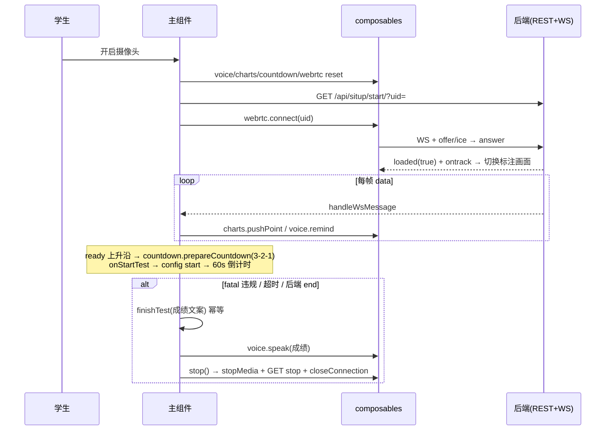

# StudentTestingSitup.vue 工作逻辑说明

> 学生端「仰卧起坐」体测页：本地摄像头采集 → WebRTC 上传后端 → 接收回传的带标注视频与逐帧检测数据 → 实时展示分数/状态/曲线，语音播报、本地录像下载。
> 路由 `/student/testingsitup`（`src/router/index.js`），页面已重构为「主组件编排 + 4 个 composable」结构。

## 1. 文件结构

```
src/views/student/
├── StudentTestingSitup.vue          482 行（模板 96 + 脚本 261 + 样式 124）
└── composables/
    ├── useTestingWebRTC.js          220 行  ws/pc 握手、摄像头、本地录像/下载
    ├── useTestCharts.js             126 行  两张折线图的创建/入库/复位
    ├── useTestCountdown.js          114 行  准备读秒 + 60s 正式倒计时
    └── useVoice.js                   48 行  语音播报 + 重复提醒节流
```

职责边界：**状态与编排留在主组件**（会话生命周期、帧数据处理、违规判定），composable 只持有自己那块状态，通过回调与主组件接线。

## 2. 模块接口

| 模块 | 返回 | 说明 |
|---|---|---|
| `useTestingWebRTC({ videoRef, onData, onLoaded, onError, onEnd })` | `cameraList` `selectedDeviceId` `hasRecordedVideo` `loadCameraList` `connect(uid)` `stopMedia()` `closeConnection()` `sendConfig(payload)` `downloadOriginVideo()` `resetRecording()` | `connect` 建 `ws://127.0.0.1:8090/ws/webrtc/<uid>/`、开摄像头、MediaRecorder 录制、SDP offer/answer；`ws.onmessage` 按类型分发：`data`→`onData`、`loaded`→`onLoaded`、`error`→`onError`、`end`→`onEnd`。`stopMedia` 停录制+本地流；`closeConnection` 关 ws/pc（修连接泄漏） |
| `useTestCountdown({ speak, onStartTest, onTimeout })` | `leftCountdownMs` `isCountingDown` `countdownDisplay` `formatCountdown` `prepareCountdown()` `cancel()` `reset()` `dispose()` | 读秒 6 拍：前 3 拍显示"准备"、后 3 拍 3/2/1（与语音同步），归零显示"开始"→ `onStartTest` → 1s 后自动启动 60s 正式倒计时 → 归零 `onTimeout`。`cancel`=停表（保留剩余时间显示，stop 用）；`reset`=停表+回满值（start 用）；`dispose`=卸载清定时器 |
| `useTestCharts(countCanvas, angleCanvas)` | `init()` `reset()` `destroy()` `pushPoint(elapsedMs, score, angle)` | 折线图工厂消除两图重复配置；tooltip 直接取轴标签（`labels[dataIndex]`）；源数组保留**全程数据**，仅展示层截取最近 900/150 点 |
| `useVoice()` | `speak(text, interrupt=true)` `remind(text)` `reset()` | `remind` 为持续提示（请平躺/手臂借力）：同文本 4 秒节流、不打断其它播报、文本变化立即重试；`reset` 清节流（新会话用） |

## 3. 主组件编排

### 3.1 `handleWsMessage` 拆分（原 ~90 行 → 4 个平级函数）

```
handleWsMessage(result)
 ├─ applyFrameData(result)   分数、状态提示（空则["正常"]）、startTime≠0 时图表入库
 ├─ applyFaceState(result.face)  人脸状态机（checking/passed/failed/timeout）
 ├─ applyReady(result)       ready 上升沿 → detectStarted=true + prepareCountdown()
 └─ applyViolations(result)  违规表驱动（见 3.2）
```

`applyReady` 保留原边沿检测语义，但 `lastReadyState` 收敛为无条件单次赋值。

### 3.2 违规表 `VIOLATIONS` 与 `finishTest`

```js
const VIOLATIONS = [
  { flag: 'is_waiting_for_flat', fatal: false, message: () => '请平躺，双腿保持不动' },
  { flag: 'is_arm_force_cheat',  fatal: false, message: () => '检测到手臂借力' },
  { flag: 'is_out_of_bounds',    fatal: true,  message: (s) => `…您的成绩为${s}个` },
  { flag: 'is_knee_move',        fatal: true,  message: (s) => `…您的成绩为${s}个` },
  { flag: 'is_assist_cheat',     fatal: true,  message: (s) => `…您的成绩为${s}个` },
]
```

- 非致命：`voice.remind()` 4 秒节流重复播报（表内优先级取第一个命中，避免两条提示逐帧互踢）。
- 致命：`finishTest(text)`。

**`finishTest(message, { speak })` 是测试结束的唯一入口**，幂等（`if (finished) return`），取代原 `hasStopSpoken` 的四处嵌套判断：

| 触发方 | 消息 | 播报 |
|---|---|---|
| 三个 fatal 违规 | 对应违规文案 | 是 |
| 超时（`onTimeout`） | `倒计时结束，您的成绩为：N个` | 是（原实现要等后端 `end` 才播） |
| 后端 `end` 消息 | `倒计时结束…`（超时过）/ `测试已结束…` | 是 |
| 后端 `error` 消息 | 无（界面显示`错误：…`） | 否（`speak:false`，抑制成绩语音） |

`finishTest` → `stop()` 关会话；`start()` 复位 `finished/timedOut/startTime` 等全部会话状态。

### 3.3 会话流程

**`start()`**：防重入 → 复位全部状态（分数/提示/人脸/finished/timedOut/startTime、`voice.reset`、`countdown.reset`、`charts.reset`、`resetRecording`）→ `GET /api/situp/start/?uid=` → 200 则 `connect(uid)`、`cameraActive=true`。

**`stop()`**：防重入 → `cameraActive=false`、`countdown.cancel()` → `stopMedia()` → `GET /api/situp/stop/?uid=` → **`finally` 中 `closeConnection()`**（无论接口成败都关 ws/pc，修泄漏）。

**读秒→计分**：`ready` 上升沿 → `prepareCountdown()`（6 拍，语音「检测完成，准备开始」→ 3/2/1 → 「开始」）→ `onStartTest`：`startTime=Date.now()` + `sendConfig({type:'config', start:true})` → 1s 后 60s 正式倒计时 → 归零 `onTimeout`。

### 3.4 WebRTC 与视频画面

- 本地流先挂 `<video>` 预览；后端回传流**只存不挂**（`remoteStream`），`loaded:true` 与 `ontrack` 双条件齐了才经 `attachRemoteIfNeeded()` 切换（幂等，修模型加载期黑屏）。
- ICE 候选、offer/answer 走 WS；STUN：Google + 小米。
- 绘图开关 → `sendConfig({type:'config', drawing})`（带 readyState 检查）。

### 3.5 人脸提示（`faceHint`）

模板中 `faceHint` 优先于 `hints` 展示：

- `checking` → 「正在进行人脸识别，请注视摄像头」（持续）
- `passed` → 「未注册学生，直接放行」/「人脸识别完成」，2s 自清（文本比对防误清）
- `failed`/`timeout` 且 `fail_count >= 3` → 「人脸识别未通过，请重试」（持续）

## 4. 时序



## 5. 与重构前的差异（行为变更）

1. **修复**：`stop()` 不关 ws/pc（`finally` 中 `closeConnection()`）。
2. **修复**：图表 tooltip 索引错误 → 直接取轴标签 `labels[dataIndex]`。
3. **修复**：`hasRecordedVideo` 在 `start()` 复位；仅真实录过（recorder 非 inactive）才置 true。
4. **修复（重构中新发现）**：`start()` 现在复位 `startTime=0`——原实现残留上一会话的 startTime，导致重启后读秒完成前就往图表灌数据且时间轴错乱。
5. **读秒显示**：原「前 4 拍都显示 3」→ 前 3 拍"准备"、后 3 拍 3/2/1，与语音同步（总时长 6 拍不变）。
6. **重复提醒**：原逐帧重播（播完立刻再来）→ 同文本 4 秒节流、不打断其它播报。
7. **超时播报时机**：原等后端 `end` 才播「倒计时结束…」→ 超时当拍即播。
8. **删除**：死代码 `count`、`isRegister`、`cleanup()`、`camIndex++`、死样式（`.video-preview` `.count-info` `.record-details*`）。
9. **重命名**：`num`→`score`、`is_timeout`→`timedOut`、`login`→`goBack`、`handleWsClose`→`handleTestEnd`、`startRecord/stopRecord`→`connect/stopMedia/closeConnection`、`countdownTimer/Interval`→`prepareTimer/testTimer`、`mediaParams`→`MEDIA_CONSTRAINTS`。
10. **顺带修复**：`eslint.config.js` 中 `globals` 被误当作 flat config 项（ESLint 全仓崩溃 exit 2），改为正确的 `languageOptions.globals` 写法。

未变更：WS/SDP 协议、REST 端点、数据载荷、模板结构、60s 测试时长、全程数据保留、人脸状态机语义。

## 6. 验证状态与注意点

- `prettier`（`semi:false, singleQuote, printWidth:100`）+ `eslint --fix` 对改动文件通过；`vite build` 通过。
- 完整冒烟（开摄像头→识别→读秒→计分→结束）需后端环境，由人工执行。
- WS 地址 `ws://127.0.0.1:8090/...` 仍硬编码在 `useTestingWebRTC.js`。
- `clearFaceHintLater` 的 `setTimeout` 未跟踪（有文本比对兜底，卸载后触发仅写已销毁组件的 ref，无害）。
- 图表源数组全程增长是**有意为之**（要记全程），展示层已截断。
