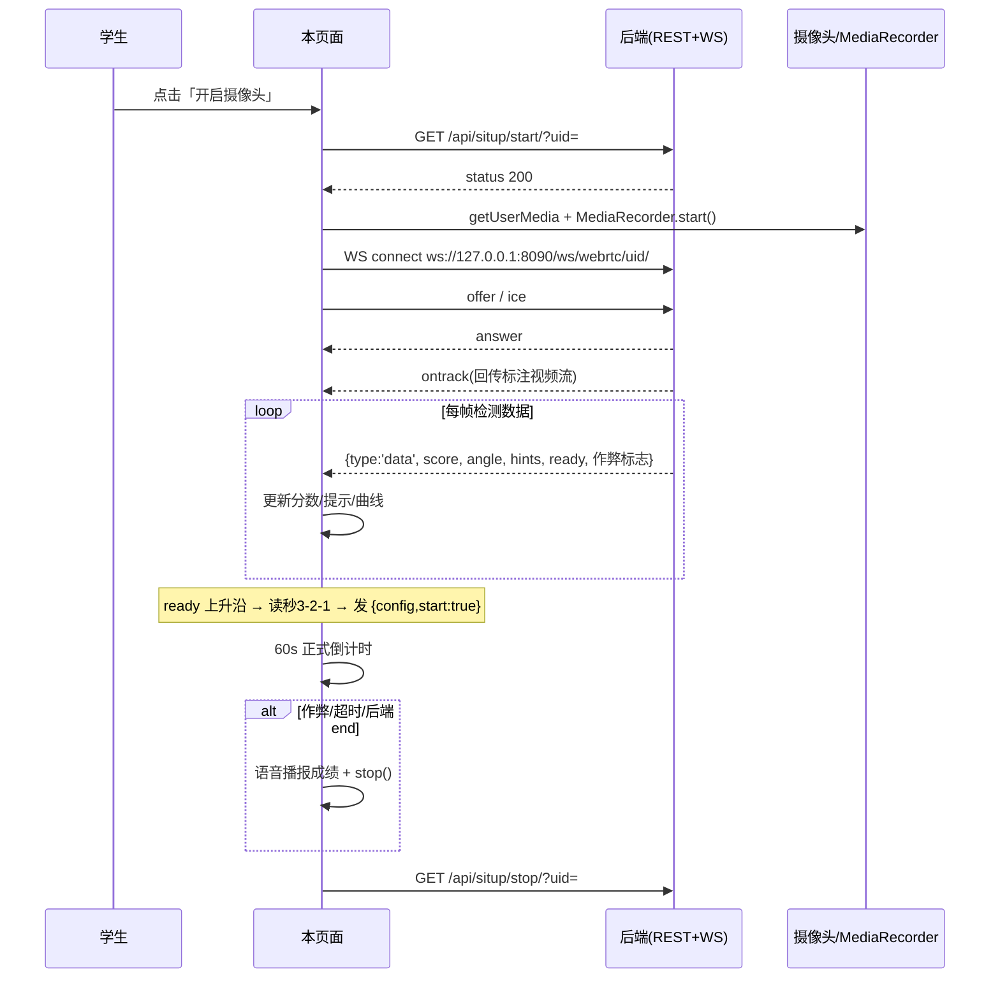

# StudentTestingSitup.vue 工作逻辑说明

> 文件：`src/views/student/StudentTestingSitup.vue`（877 行）
> 路由：`/student/testingsitup`（`src/router/index.js:30`，懒加载）
> 用途：学生端「仰卧起坐」体测页 —— 本地摄像头采集 → WebRTC 上传后端 → 接收回传的带标注视频与逐帧检测数据 → 实时展示分数/状态/曲线，并播报语音、支持本地录像下载。

## 1. 页面结构（template）

三块区域，纵向排列：

| 区域 | 内容 |
|---|---|
| `.camera-chart-container` | 左 60%：`<video ref="resultVideo">`，初始显示本地摄像头画面，WebRTC 建立后被替换为**后端回传的带骨骼标注视频流**；右：`分数`（`{{ num }}`）与 `状态`（`hints` 列表逐条渲染） |
| `.control-buttons` | 开启摄像头（`start()`，`cameraActive` 时禁用）、关闭摄像头（`stop()`）、摄像头下拉选择（`selectedDeviceId`，开启中禁用）、返回（`router.push('/student/test')`）、绘图开关（`drawingEnabled`）、下载原视频（`cameraActive` 或无录像时禁用） |
| `.info-container` | 三列卡片：①倒计时（读秒阶段显示 `countdownDisplay`，否则显示 `formatCountdown(leftCountdownMs)` 即 `MM:SS`）；②个数折线图 `countChartElement`；③起伏角度折线图 `angleChartElement` |

## 2. 关键状态

- 会话控制：`cameraActive`、`detectStarted`（是否已进入读秒）、`is_timeout`、`startTime`（正式开始时刻，0 表示未开始）
- 倒计时：`COUNTDOWN_TOTAL_MS = 60_000`、`leftCountdownMs`、`countdownInterval`（正式倒计时定时器）、`isCountingDown` / `countdownTimer` / `countdownDisplay`（3 秒读秒阶段）
- 数据：`num`（当前分数，来自后端 `score`）、`hints`（状态提示）、`timestamps[]` / `nums[]` / `angles[]`（图表数据，非响应式普通数组）
- 图表：`countChartInstance` / `angleChartInstance`（Chart.js 实例，普通变量）
- 连接与录制：`webrtc = { pc, ws }`、`mediaStream`、`mediaRecorder`、`recordedChunks`、`hasRecordedVideo`
- 语音：`hasStopSpoken`（保证结束语只播一次）
- 摄像头：`cameraList` / `selectedDeviceId`（`enumerateDevices` 枚举 videoinput）
- 用户：`username = localStorage.getItem('username')`，作为所有接口的 `uid`
- 未被读取的死状态：`count`、`isRegister`（只写不读）

## 3. 核心流程

### 3.1 `start()` — 开启测试

1. 防重入：`cameraActive` 已为真直接返回。
2. 复位：分数/数组/hints（置为 `连接中...`）、`detectStarted`、`lastReadyState`、读秒状态、倒计时（`leftCountdownMs = 60000`）、`is_timeout`、销毁两张图表、`cleanup()`。
3. 重建两张图表 `initCountChart()` / `initAngleChart()`。
4. `await start_monitor_situp(username)` → `GET /api/situp/start/?uid=<username>`；返回 `status === 200` 时调用 `startRecord(username)` 建立 WebRTC，并置 `cameraActive = true`；失败则回滚 `cameraActive/isRegister`。

### 3.2 `createWebRTC(uid)` — 连接建立

```
ws = new WebSocket('ws://127.0.0.1:8090/ws/webrtc/<uid>/')   // 地址硬编码
```

`ws.onopen`：

1. `openCamera()`：`getUserMedia`（640×480、理想 15fps、无音频；已选设备时加 `deviceId: { exact }`），挂到 `resultVideo`。
2. `startLocalRecording()`：`MediaRecorder`（`video/mp4`）开始本地录像。
3. 创建 `RTCPeerConnection`（STUN：`stun.l.google.com:19301`、`stun.miwifi.com:3477`）。
4. `addTrack` 本地所有轨道，视频轨道设 `contentHint = 'detail'`。
5. `ontrack`：**后端回传流覆盖 `resultVideo.srcObject`**（画面从本地预览变为标注画面）。
6. `onicecandidate`：ICE 候选以 `{type:'ice', candidate}` 经 ws 发送。
7. `createOffer` → `setLocalDescription` → 发送 `{type:'offer', sdp}`。

`ws.onmessage` 按 `msg.type` 分发：

- `answer` → `setRemoteDescription` 完成 SDP 协商
- `data` → `handleWsMessage(msg.data)`（检测数据）
- `end` → `handleWsClose()`（后端宣告测试结束）

返回 `{ pc, ws }` 存入 `webrtc`，供绘图开关与读秒结束时下发 config 使用。

### 3.3 `handleWsMessage(result)` — 逐帧数据处理

1. 展示：`num = result.score`，`hints = result.hints || ['正常']`。
2. 入图：`startTime !== 0`（已正式开始）时把 `timestamp / score / angle` 压入三个数组并 `updateCharts()`。
3. **ready 边沿检测**：`ready` 由假变真且 `detectStarted` 为假 → `startPrepareCountdown()` 进入读秒（只触发一次）。
4. 作弊/异常分支（整体受 `!hasStopSpoken` 保护）：
   - `is_waiting_for_flat` → 播报「请平躺，双腿屈膝固定」
   - `is_arm_force_cheat` → 播报「检测到手臂借力」
   - `is_out_of_bounds` → 播报「检测到身体移出画面，本次测试结束，您的成绩为 N 个」，置 `hasStopSpoken`，调用 `stop()`
   - `is_knee_move` → 播报「检测到大幅移动…本次测试结束…」，置 `hasStopSpoken`，调用 `stop()`
   - `is_assist_cheat` → 播报「检测到可能有人助力…本次测试结束…」，置 `hasStopSpoken`，调用 `stop()`

即：除前两条仅提示外，其余三项都会**由前端直接结束本次测试**并播报最终成绩。

### 3.4 两段倒计时

**准备读秒** `startPrepareCountdown()`（由 ready 边沿触发）：

- `detectStarted=true`、`isCountingDown=true`，播报「检测完成，准备开始」。
- 内部计数从 6 起，每秒递减：显示文本为 `countdown >= 3 ? '3' : countdown`，因此 UI 呈现 `3 → 3 → 3 → 3 → 2 → 1`；当递减到 `<= 3` 时语音读出数字。
- 归零分支：清定时器、显示「开始」、`startTime = Date.now()`、语音「开始」、**向 ws 发送 `{type:'config', start:true}`** 通知后端开始计分；1 秒后退出读秒态，调用 `startTestCountdown()`。

**正式测试倒计时** `startTestCountdown()`：

- 每秒 `leftCountdownMs -= 1000`；到 0 时置 `is_timeout = true` 并调用 `stop()` 结束测试。

### 3.5 `stop()` — 关闭测试

1. 防重入（`cameraActive` 为假返回），置 `cameraActive=false`。
2. 清两个定时器，退出读秒态。
3. `stopRecord()`：停 `MediaRecorder`（`hasRecordedVideo=true`）、停掉 `mediaStream` 全部轨道并置空。
4. `await stop_monitor_situp(username)` → `GET /api/situp/stop/?uid=<username>`。
5. 注意：`stop()` **不关闭 WebSocket 和 RTCPeerConnection**，也不清空 `webrtc`。

### 3.6 结束语 `handleWsClose()`

受 `hasStopSpoken` 保护只播一次：`is_timeout` 为真播「倒计时结束，您的成绩为：N 个」，否则播「测试已结束，您的成绩为：N 个」。因此「超时结束」的语音实际依赖后端随后下发的 `end` 消息（前端超时只调用 `stop()`）。

## 4. 时序



## 5. 图表与录像

- 两张 Chart.js 折线图，`animation:false`、`pointRadius:0`。
  - 个数图：蓝 `#2d7acd`，y 轴「个数」，最多保留 `15*60 = 900` 点。
  - 角度图：绿 `#67c23a`，y 轴 `beginAtZero`、`suggestedMax: 60`，最多保留 `15*10 = 150` 点。
- X 轴标签：`formatTimestamp(ts - startTime)`，即相对开始时刻的 `mm:ss`（`formatTimestamp` 把毫秒差当作 epoch 时间取分秒）。
- 数据仅在 `startTime !== 0` 后入图，因此读秒期间曲线不动。
- 本地录像：`recordedChunks` → `downloadOriginVideo()` 打包 `video/mp4` Blob，命名 `situp_yyyyMMdd_HHmmss.mp4`。
- 绘图开关：`onDrawingToggle` 向 ws 发 `{type:'config', drawing: bool}`，由后端决定是否在回传画面上绘制骨架；开关不同步本地状态（依赖后端）。

## 6. 生命周期

- `onMounted`：初始化两张图表 + `loadCameraList()` 枚举摄像头。
- `onUnmounted`：清两个定时器、销毁图表、`cleanup()`，若仍 `cameraActive` 则调用 `stop()`。

## 7. 实现注意点（现状记录）

1. `stop()` 未关闭 `ws` / `pc`，`webrtc` 引用残留；重复开启会新建 WS，旧连接依赖服务端超时回收。
2. WS 地址 `ws://127.0.0.1:8090/...` 硬编码，换环境需改代码。
3. `count`、`isRegister` 只写不读，属死状态。
4. 摄像头下拉 label 用 `camIndex++` 兜底命名，每次渲染递增，序号不稳定。
5. 图表 tooltip 用原始 `timestamps` 换算，与轴标签的 `ts - startTime` 口径不一致。
6. 结束分支里 `is_knee_move` 先置 `hasStopSpoken` 再播报，其余分支先播报再置位，行为等价但写法不统一。
7. 超时（`is_timeout`）时前端仅 `stop()`，成绩语音要等后端 `end` 消息才播。
